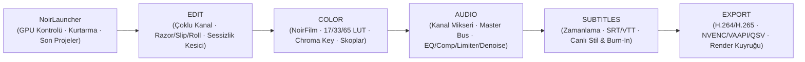

<div align="center">


# NOIRCUT STUDIO

**Sinema Karanlık Odası & Profesyonel Masaüstü Video Kurgu / Post-Prodüksiyon Sistemi**

[](https://github.com/lakhermony/NoirCut)
[](https://github.com/lakhermony/NoirCut)
[](https://github.com/lakhermony/NoirCut)

*Aboneliksiz, bulut kilitsiz, yerel WebGL2 GPU renk motoru ve gömülü/sistem FFmpeg gücüyle çalışan modern çok kanallı doğrusal olmayan video düzenleyici (NLE).*

[Özellikler](#temel-özellikler) · [Çalışma Alanları](#çalışma-alanları) · [Kurulum & Geliştirme](#kurulum-ve-geliştirme) · [Klavye Kısayolları](#klavye-kısayolları) · [Dokümantasyon](#dokümantasyon)

</div>

---

## Vizyon ve Yaklaşım

**NoirCut**, klasik ağır kurgu yazılımlarının karmaşıklığı ile bulut/abonelik dayatan araçlar arasında sıkışan bağımsız sinemacılar, kurgucular ve atmosferik içerik üreticileri için tasarlanmıştır.

- **Tamamen Yerel ve Çevrimdışı:** Videolarınız ve sesleriniz hiçbir uzak sunucuya yüklenmez; medya analizi, renk işleme, ses miksajı ve dışa aktarma tamamen kendi bilgisayarınızda gerçekleşir.
- **Kesintisiz Çift Tamponlu (Gapless Dual-Buffer) Oynatma:** Aktif ve yedek (`A/B`) `<video>` tamponları, `requestVideoFrameCallback`, sıfır React re-render (`subscribeTime` DOM transform) ve `EDIT` modunda doğrudan donanım hızlandırmalı video katmanı ile 60 FPS akıcı önizleme.
- **Önizleme = Çıktı Tutarlılığı:** Monitörde WebGL2 GPU ile gördüğünüz renk derecelendirme, 3D LUT (`17/33/65`), Chroma Key, transform keyframe, altyazı katmanı ve ses miksajı; dışa aktarmada aynı matematikle FFmpeg'e (`bakeColorGradeToCube` + `filter_complex`) işlenir.
- **Dinamik Tema Entegrasyonu:** 5 yerleşik karanlık oda teması (**NoirCut Lime `#B7E36A`**, **Saf Monokrom**, **Gece Mavisi**, **Sıcak Tungsten**, **NoirCut Kırmızısı `#E11D48`**) ve aktif temaya anında uyum sağlayan 3 katmanlı (`Header + Filmstrip + Waveform`) timeline klip kartları.

---

## Temel Özellikler (v1.0.4)

### 1. Gelişmiş Çok Kanallı Timeline & Hassas Kurgu (`EDIT`)
- **Çoklu Video ve Ses Kanalları (`V1..Vn`, `A1..An`):** Sınırsız video/ses kanalı ekleme, kanal kilitleme (`Lock`), gizleme (`Hide`), susturma (`Mute`), `Solo`, kanal çoğaltma (`Duplicate`) ve yukarı/aşağı yeniden sıralama (`Reorder`).
- **3 Katmanlı Filmstrip Klip Kartları:** Yakınlaştırma (zoom) seviyesine göre dinamik yoğunluklu sürekli video film şeridi (`FilmstripCanvas`), gerçek 4000 Hz PCM ses dalga formu (`WaveformCanvas`) ve dinamik tema kenarlıkları.
- **Çoklu Klip Seçimi & Grup İşlemleri:** `Ctrl+A` (Tümünü Seç), `Esc` (Seçimi Temizle), `Shift/Ctrl + Sol Tık`, **Sol Tık + Sürükleme Seçim Kutusu (Marquee / Rubber-Band)**, toplu taşıma, toplu silme, **Klip Gruplama (`Ctrl+G`)**, **A/V Bağlama (`Link / Unlink`)** ve **İç İçe Sekans (`Nested Sequence / Compound Clip`)**.
- **Profesyonel NLE Kurgu Araçları:**
  - `Select (V)`: Sıkı manyetik kenetlenme (**Strict Magnetic Snapping**) ile 0ms boşluksuz taşıma ve kenar kırpma.
  - `Razor (B / C)`: Tekli, bağlı (Linked A/V) veya gruplu klipleri kare hassasiyetinde bölme.
  - `Slip (Y)`: Klibin timeline konumunu ve süresini değiştirmeden içerideki kaynak `in/out` penceresini kaydırma.
  - `Roll (N)`: İki bitişik klibin birleşim noktasını (hem sol hem sağ kenardan) toplam süreyi bozmadan eşzamanlı kaydırma.
  - `Ripple Modu & Boşluk Kapatma`: Sol/sağ Ripple Trim, `Shift+Del` Ripple Silme ve iki klip arasındaki boşluğa sağ tıklayarak **Boşluğu Kapat (Ripple Delete Gap)**.
- **Otomatik Sessizlik Algılama (Silence Detection):** Ayarlanabilir dB eşiği (`-60..-15 dB`), minimum sessizlik süresi (`0.2..3.0 sn`) ve güvenlik payı (`padding ms`) ile sessiz bölgeleri tarama; yıkıcı olmayan işaretçi ekleme veya kullanıcı onaylı otomatik Ripple kesim (A/V senkron korumalı).
- **Klip Efektleri & Keyframe:** `Scale`, `Position X/Y`, `Rotation`, `Opacity` için `linear` / `ease-in-out` keyframe animasyonu, hız (`%25–%400`), ters oynatma (`Reverse`) ve geçişler (`Cross Dissolve`, `Dip to Black`).

### 2. Akıllı Proxy Sistemi & Medya Yönetimi (`PROXY`)
- **Çoklu Çözünürlük Ölçekleri:** `1/2` (`720p`), `1/4` (`540p`) ve `1/8` (`270p`) ölçeklerinde `-g 1` (All-Intra) anında arama (fast-seek) destekli arka plan Smart Proxy üretimi (NVENC GPU veya `ultrafast` CPU).
- **Canlı Oynatma Modu & Önizleme Kalitesi:** Üst bardan `Otomatik`, `Proxy` ve `Orijinal` medya arasında anında geçiş; WebGL2 kanvası için `Tam (1x)`, `1/2` ve `1/4` önizleme çözünürlüğü seçimi.
- **Kayıp Medya Kurtarma & Tam Çözünürlükte Çıktı:** Taşınmış/silinmiş kaynak dosyaları yeniden bağlama (`relocateMissingMedia`); kurgu proxy ile yapılsa bile dışa aktarmada (Render) her zaman orijinal yüksek çözünürlüklü kaynak dosyaları kullanma.

### 3. WebGL2 Renk Laboratuvarı & NoirFilm Motoru (`COLOR`)
- **3D LUT Motoru (`17³ / 33³ / 65³`):** 19 yerleşik sinematik LUT, özel `.cube` yükleme, yoğunluk (`0–100%`) kontrolü ve dışa aktarma için trilinear 3D LUT pişirme (`bakeColorGradeToCube`).
- **Birincil & İkincil Renk Kontrolleri:** Kamera Log profilleri (`Rec.709`, `S-Log3`, `C-Log3`, `V-Log`, `Arri LogC3`), **Auto WB**, **Eyedropper (Damlalık WB)**, **Lift · Gamma · Gain · Offset** tekerlekleri, özel **RGB & Luma Eğrileri** ve **8-Vektör HSL Seçici Renk** (`Hue`, `Saturation`, `Luminance`).
- **Film Emülasyonu & Optik Efektler:** `Kodak 2383`, `Fujifilm 3513`, `Kodak Vision3 500T 5219`, `Ilford HP5 Plus 400`, `Silver Noir Contrast` film stokları; **Halation**, **Bloom**, **Mist / Diffusion** ve **35mm/16mm/8mm Film Grain**.
- **Chroma Key (Yeşil / Mavi Perde):** Özel anahtar renk seçici, tolerans, kenar yumuşatma (`Edge Softness`), renk sızıntısı bastırma (`Spill Suppression`), arka plan rengi birleştirme (`V1`) ve şeffaf PiP bindirme (`V2+`).
- **Canlı Skoplar & Kıyaslama:** Throttled (`~10fps`, `128×72`) **Waveform**, **RGB Parade**, **Vectorscope**, **Histogram**, **False Color**, **Before/After Wipe** bölünmüş ekran ve **Grab Still** referans galerisi.

### 4. Profesyonel Ses Mikseri & DSP Zinciri (`AUDIO`)
- **Çok Kanallı Mikser & Master Bus:** Her ses ve video kanalı için bağımsız seviye (`-60..+12 dB`), `Pan` (`-100..+100`), `Mute`, `Solo`, canlı tepe ölçerler (`Peak Meters`) ve canlı önizleme + dışa aktarma senkronlu **Master Bus Fader** (`masterGainDb`).
- **Klip Bazlı Ses Efekt Zinciri:**
  - **3-Bant Parametrik EQ:** `Low (100Hz)`, `Mid (1kHz)`, `High (8kHz)` (`-12..+12 dB`).
  - **Dynamics:** **Compressor** (Eşik `-40..0 dB`, Oran `1:1..12:1`) ve **Brickwall Limiter** (`-12..0 dB`).
  - **Akustik & Temizlik:** **Reverb / Oda Yankısı** (`0..100%`), **FFT Gürültü Azaltma (`afftdn` + `80Hz Highpass`)** ve **Auto-Ducking** (diyalog anında müziği otomatik `-11 dB` kısma).
- **Prosedürel Noir Soundscape:** Tek tıkla sentezlenen 4 sinematik ses atmosferi (`Gerilim Riser`, `Sub Drop`, `35mm Film Projektörü`, `Gece Yağmuru`).

### 5. Altyazı Stüdyosu (`SUBTITLES`)
- **Ses Zarfı Segmentasyonu & Zamanlama:** Ses kanallarındaki konuşma aktivitesi zarfını tarayarak otomatik zaman dilimleri oluşturma, manuel satır ekleme/bölme/birleştirme ve CPS (saniyedeki karakter) okuma hızı analizi.
- **SRT / VTT & Burn-In Dışa Aktarma:** Standart `.srt` ve `.vtt` altyazı dosyası içe/dışa aktarma; özelleştirilebilir font, boyut, renk, arka plan opaklığı ve konum (`Alt`, `Orta`, `Üst`) ile Program Monitöründe canlı önizleme ve videoya kalıcı gömme (**PNG Overlay Burn-In**).

### 6. Kült Sinema Tipografisi & Jenerik (`TEXT / CREDITS`)
- **5 Sinematik Şablon & 20 Font + Özel TTF/OTF:** `Classic Rolling Credits`, `Noir Opening Title`, `Minimalist Lower Third`, `Chapter Card`, `Standard Text`; **TR → EN ASCII Dönüştürücü**, Neon Glow, Daktilo efekti, 35mm Gate Weave ve sentetik Foley ses senkronu.

### 7. Toplu Render Kuyruğu & Donanım Hızlandırma (`EXPORT`)
- **Çoklu Codec & Donanım Kodlayıcıları:** `H.264` (`libx264`, `h264_nvenc`, `h264_vaapi`, `h264_qsv`, `h264_amf`) ve `H.265 / HEVC` (`libx265`, `hevc_nvenc`) desteği; çalışma zamanında donanım hatası olursa otomatik `libx264` CPU fallback.
- **Batch Render Queue:** Kuyruğa birden fazla çözünürlük/format/bit hızı işi ekleme, gerçek süreç duraklatma/devam ettirme (`SIGSTOP` / `SIGCONT`), iptal (`SIGTERM` + yarım dosya temizliği), yeniden deneme (`Retry`), canlı **ETA (Kalan Süre)** ve zaman damgalı **Render Günlükleri**.
- **7 Hazır Platform Profili:** `YouTube 1080p`, `YouTube 4K`, `Social Media`, `Social Vertical (9:16)`, `High Quality Master (MOV)`, `Sinema 24p Noir` ve `Hızlı Taslak`.

---

## Çalışma Alanları



---

## Kurulum ve Geliştirme

### Son Kullanıcı Kurulumu
- **Linux (x64):** [Releases](https://github.com/lakhermony/NoirCut/releases) sayfasından `.AppImage` dosyasını indirin (veya kaynak koddan üretin), çalıştırma izni verin ve başlatın:
  ```bash
  chmod +x NoirCut-1.0.4.AppImage
  ./NoirCut-1.0.4.AppImage
  ```
- **Windows (x64):** Taşınabilir `.exe` (portable) veya NSIS kurulum sihirbazı ile çalıştırılabilir *(paketleme sırasında `resources/bin/win/ffmpeg.exe` gerektirir)*.

### Geliştirici Kurulumu

**Gereksinimler:** Node.js `>= 20` ve npm.

```bash
# 1. Depoyu klonlayın
git clone https://github.com/lakhermony/NoirCut.git
cd NoirCut

# 2. Bağımlılıkları yükleyin
npm install

# 3. Geliştirme modunda başlatın (Electron + Vite HMR)
npm run dev

# 4. Tip kontrolü ve üretim derlemesi
npm run typecheck
npm run build
```

### Masaüstü Paketi Oluşturma
```bash
# Linux AppImage (dist/NoirCut-1.0.4.AppImage)
npm run dist:linux

# Windows Portable & NSIS Setup (resources/bin/win/ffmpeg.exe mevcutsa)
npm run dist:win
```

---

## Klavye Kısayolları

| Kısayol | İşlev |
| :--- | :--- |
| `Space` | Oynat / Durdur |
| `J` / `K` / `L` | Geri sar (`1x`/`2x`) · Durdur · İleri oynat (`1x`/`2x`/`4x`) |
| `V` / `B` / `Y` / `N` | Seçim (`Select`) · Jilet (`Razor`) · Kaydırma (`Slip`) · Rulo (`Roll`) aracı |
| `C` | Playhead konumundan kes (Razor) |
| `Ctrl + A` / `Esc` | Timeline'daki tüm klipleri seç / Seçimi temizle |
| `Ctrl + G` | Seçili klipleri grupla / Grubu çöz |
| `Del` / `Backspace` | Seçili klipleri sil *(Ripple Modu açıksa sonraki klipleri kaydırır)* |
| `Shift + Del` | **Ripple Sil** — Seçili klipleri sil ve boşluğu otomatik kapat |
| `I` / `O` | Giriş (In) ve Çıkış (Out) noktası işaretle |
| `M` | Sahne İşaretçisi (`Case Marker`) ekle |
| `Ctrl + Z` / `Ctrl + Shift + Z` | Geri Al / Yinele |
| `Ctrl + S` / `Ctrl + O` | Projeyi Kaydet (`.noircut`) / Proje Aç |
| `Ctrl + Fare Tekerleği` | Zaman çizelgesini yakınlaştır / uzaklaştır |

---

## Mimari Dizin Yapısı

```text
src/
├── main/                   # Electron ana süreç (FFmpeg motoru, Smart Proxy, medya protokolü, export, autosave, updater)
├── preload/                # contextBridge IPC API (window.noircut)
├── shared/                 # Renderer ve Main arası paylaşılan saf modeller & matematik (color, lut, noirfilm, timeline, credits)
└── renderer/src/           # React 19 arayüzü, WebGL2 shader motoru, 5 çalışma alanı, Filmstrip ve Waveform Canvas bileşenleri
docs/
├── KULLANIM_KILAVUZU.md    # Son kullanıcı adım adım kullanım rehberi
├── ANALIZ_RAPORU.md        # Kod tabanı teknik analiz raporu
└── OZELLIK_ONERILERI.md    # Ürün keşfi, rakip analizi ve yol haritası
```

---

<div align="center">

**NoirCut Studio v1.0.4** · Copyright © 2026 NoirCut Studio

</div>
