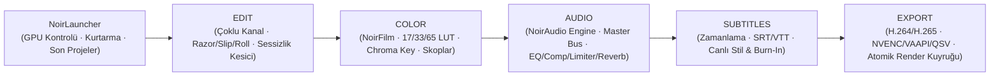

<div align="center">


# NOIRCUT STUDIO

**Sinema Karanlık Odası & Profesyonel Masaüstü Video Kurgu / Post-Prodüksiyon Sistemi**

[](https://github.com/lakhermony/NoirCut)
[](https://github.com/lakhermony/NoirCut/actions/workflows/ci.yml)
[](https://github.com/lakhermony/NoirCut)
[](https://github.com/lakhermony/NoirCut)
[](LICENSE)

*Aboneliksiz, bulut kilitsiz, Electron 45 ana süreci, yerel WebGL2 GPU renk motoru, Web Audio API (`NoirAudio Engine`) ve gömülü/sistem FFmpeg gücüyle çalışan modern çok kanallı doğrusal olmayan video düzenleyici (NLE).*

[İndirme & Boyutlar](#indirme-ve-paket-boyutları-v105) · [Özellik Envanteri](#özellik-envanteri-ve-olgunluk-durumu-v105) · [Çalışma Alanları](#çalışma-alanları) · [Kurulum & Geliştirme](#kurulum-ve-geliştirme) · [Klavye Kısayolları](#klavye-kısayolları) · [Dokümantasyon](#dokümantasyon)

</div>

---

## Vizyon ve Yaklaşım

**NoirCut**, klasik ağır kurgu yazılımlarının karmaşıklığı ile bulut/abonelik dayatan araçlar arasında sıkışan bağımsız sinemacılar, kurgucular ve atmosferik içerik üreticileri için tasarlanmıştır.

- **Tamamen Yerel ve Çevrimdışı:** Videolarınız ve sesleriniz hiçbir uzak sunucuya yüklenmez; medya analizi, renk işleme, ses miksajı ve dışa aktarma tamamen kendi bilgisayarınızda gerçekleşir.
- **Kesintisiz Çift Tamponlu (Gapless Dual-Buffer) Oynatma:** Aktif ve yedek (`Slot A / Slot B`) `<video>` tamponları, `requestVideoFrameCallback`, sıfır React re-render (`subscribeTime` DOM transform) ve `EDIT` modunda doğrudan donanım hızlandırmalı video katmanı ile 60 FPS akıcı önizleme.
- **Önizleme = Çıktı Tutarlılığı:** Program Monitöründe WebGL2 GPU ile gördüğünüz renk derecelendirme, 3D LUT (`17/33/65`), Chroma Key, transform keyframe, altyazı katmanı ve `NoirAudio Engine` üzerinde duyduğunuz gerçek zamanlı ses miksajı/DSP zinciri; dışa aktarmada aynı matematikle FFmpeg'e (`bakeColorGradeToCube` + `filter_complex`) işlenir.
- **Dinamik Tema Entegrasyonu:** 5 yerleşik karanlık oda teması (**NoirCut Lime `#B7E36A`**, **Saf Monokrom**, **Gece Mavisi**, **Sıcak Tungsten**, **NoirCut Kırmızısı `#E11D48`**) ve aktif temaya anında uyum sağlayan 3 katmanlı (`Header + Filmstrip + Waveform`) timeline klip kartları.

---

## Özellik Envanteri ve Olgunluk Durumu (v1.0.6)

Her özelliğin mevcut gerçek durum etiketi aşağıda şeffaf biçimde belirtilmiştir:
- `STABLE`: Test edilmiş ve tam kapsamlı çalışıyor.
- `PARTIAL`: Kısmen uygulanmış veya önizleme/export arasında bilinen fark bulunuyor.
- `EXPERIMENTAL`: Deneysel olarak çalışıyor.
- `PLANNED`: Henüz uygulanmamış, gelecek sürümler için planlandı.

### 1. Timeline ve Kurgu Çekirdeği (`EDIT`)

| Özellik | Durum | Teknik Açıklama |
| :--- | :---: | :--- |
| **Çoklu Video ve Ses Kanalları (`V1..Vn`, `A1..An`)** | `STABLE` | Dinamik video/ses kanalı ekleme, silme, çoğaltma (`Duplicate`) ve yeniden sıralama (`Reorder`). |
| **Kanal Kontrolleri (`Lock`, `Hide`, `Mute`, `Solo`)** | `STABLE` | Kanal kilitleme, gizleme, susturma ve solo; Undo/Redo geçmişinde tam korunur. |
| **3 Katmanlı Filmstrip & Waveform Klip Kartları** | `STABLE` | Zoom seviyesine göre dinamik kare yoğunluklu `FilmstripCanvas`, 4000 Hz PCM `WaveformCanvas` ve dinamik tema kenarlıkları. |
| **Çoklu Klip Seçimi (`Ctrl+A`, `Esc`, Marquee Box, `Shift+Click`)** | `STABLE` | Kauçuk bant (Marquee) seçim kutusu, toplu sürükleme, toplu silme ve grup hizalama. |
| **Kurgu Araçları (`Select V`, `Razor B`, `Slip Y`, `Roll N`, `Ripple`)** | `STABLE` | Sol ve sağ kenarlarda Roll ve Ripple kırpma, `0 ms` sıkı manyetik kenetlenme (`findStrictSnap`), `Shift+Del` Ripple Silme ve sağ tık boşluk kapatma (`rippleCloseGap`). |
| **Klip Gruplama (`Ctrl+G`) & Bağlı A/V (`Link / Unlink`)** | `STABLE` | Video ve ses kliplerini bağlama/çözme; Razor kesimi sonrasında sol ve sağ parçaların `linkedClipId` eşleşmesini otomatik koruma. |
| **İç İçe Sekanslar (`Nested Sequences / Compound Clips`)** | `STABLE` | Çok katmanlı iç içe sekans oluşturma/çözme; `flattenNestedClips` ile hem canlı önizlemede hem FFmpeg dışa aktarmada alt kliplerin tam zaman ofsetleriyle oynatılması. |
| **Klip Transform & Keyframe Animasyonu** | `STABLE` | `Scale`, `Position X/Y`, `Rotation`, `Opacity` için `linear` ve `ease-in-out` keyframe interpolasyonu. |
| **Speed Ramp (Değişken Hız Eğrisi)** | `STABLE` | Klip içi sabit hızın yanında çok noktalı keyframe hız eğrisi (`%25–%400` Slow-Mo / Pulse / Hızlan), önizleme integrasyonu ve FFmpeg export uyumu. |
| **Sürüklenebilir Ses/Opaklık Keyframe Çizgisi (Rubberband)** | `STABLE` | Doğrudan timeline klibi üzerinde `Shift+Tık`/`Çift Tık` ile ses (dB) ve opaklık kontrol noktası ekleme, sürükleme ve silme. |
| **Geçiş Efektleri Galerisi (`Transitions`)** | `STABLE` | `Cross Dissolve`, `Dip to Black`, `Wipe Left`, `Slide Left`, `Zoom In` ve `Film Burn` geçişleri (canlı önizleme + FFmpeg export). |
| **İkili Monitör (Source + Program) & Kare Snapshot** | `STABLE` | Kütüphanedeki videoyu sol Source Monitörde izleyip `I`/`O` ile 3-Point Editing yapma ve tek tıkla PNG kare anlık görüntüsü (`Snapshot`) alma. |
| **Otomatik Sessizlik Algılama (Silence Detection)** | `STABLE` | Ayarlanabilir dB eşiği, minimum süre ve `padding ms` ile sessiz bölgeleri tarama; işaretçi ekleme veya kullanıcı onaylı Ripple kesim. |
| **Undo / Redo Geçmişi, Autosave & Proje Paketleme** | `STABLE` | Döngüsel referans korumalı derin kopyalama, 8 sn atomik `.tmp` autosave ve **Paketle (Archive/Consolidate)** ile tüm medyaları tek taşınabilir klasörde toplama. |

### 2. Akıllı Proxy ve Medya Yönetimi (`PROXY`)

| Özellik | Durum | Teknik Açıklama |
| :--- | :---: | :--- |
| **Çoklu Çözünürlük Smart Proxy (`1/2`, `1/4`, `1/8`)** | `STABLE` | `1080p`, `4K` ve `8K` kaynaklar için monoton azalan, çift sayılı, büyütme yapmayan `-g 1` (All-Intra) arka plan H.264 proxy üretimi. |
| **Canlı Proxy / Orijinal Geçişi & Önizleme Kalitesi** | `STABLE` | `Otomatik`, `Proxy`, `Orijinal` medya kaynak geçişi ve WebGL2 `Tam (1x)`, `1/2`, `1/4` çözünürlük ölçekleme. |
| **Kayıp Medya Kurtarma & Orijinal Medyadan Export** | `STABLE` | Eksik dosyaları yeniden bağlama (`reconnectMediaItem`); dışa aktarmada her zaman orijinal tam çözünürlüklü kaynakları kullanma. |

### 3. NoirFilm Renk Laboratuvarı (`COLOR`)

| Özellik | Durum | Teknik Açıklama |
| :--- | :---: | :--- |
| **3D LUT Motoru (`17³`, `33³`, `65³` `.cube`)** | `STABLE` | 19 yerleşik LUT, özel `.cube` yükleme ve dışa aktarma için trilinear 3D LUT pişirme (`bakeColorGradeToCube`). |
| **Maskeleme & Sansür (`Power Window / Blur / Mosaic / Vignette`)** | `STABLE` | Elips veya dikdörtgen alan seçimiyle yüz/plaka sansürü (`Gaussian Blur`, `Mozaik`) ve ayarlanabilir `Vignette` (canlı önizleme + FFmpeg export). |
| **Birincil & İkincil Renk Araçları (LGG, Offset, Curves, HSL)** | `STABLE` | Kamera Log profilleri (`Rec.709`, `S-Log3`, `C-Log3`, `V-Log`, `Arri LogC3`), Auto WB, Damlalık WB, Lift/Gamma/Gain/Offset, RGB/Luma eğrileri ve 8-vektör HSL seçici renk. |
| **Film Emülasyonu & Optik Efektler** | `STABLE` | `Kodak 2383`, `Fujifilm 3513`, `Kodak 5219`, `Ilford HP5`, `Silver Noir` film stokları; Halation, Bloom, Mist/Diffusion ve Film Grain. |
| **Chroma Key (Yeşil / Mavi Perde)** | `STABLE` | Özel anahtar renk, tolerans, kenar yumuşatma, spill bastırma; `V1` kanalında özel `bgColor` arka plan birleştirme ve `V2+` kanallarında şeffaf bindirme. |
| **Canlı Video Skopları & Before/After Kıyaslama** | `STABLE` | Throttled (`~95ms`, `128×72`) Waveform, RGB Parade, Vectorscope, Histogram, False Color, Wipe bölünmüş ekran ve Grab Still galerisi. |

### 4. NoirAudio Engine ve Ses Stüdyosu (`AUDIO`)

| Özellik | Durum | Teknik Açıklama |
| :--- | :---: | :--- |
| **NoirAudio Engine (`Web Audio API` 48 kHz)** | `STABLE` | Tekil `AudioContext`, `WeakMap` tabanlı `MediaElementAudioSourceNode` yönetimi (`InvalidStateError` korumalı), `+12 dB` headroom ve `12 ms` tıklamasız geçişler. |
| **Çok Kanallı Mikser, Master Bus & Stereo Pan** | `STABLE` | Kanal bazlı `Gain` (`-60..+12 dB`), `StereoPannerNode` (`-100..+100` Pan), `Mute/Solo`, `Master Bus Fader` ve gerçek zamanlı `AnalyserNode` dBFS ölçerler. |
| **3-Bant Parametrik EQ (`100Hz`, `1kHz`, `8kHz`)** | `STABLE` | Canlı önizlemede `3x BiquadFilterNode` ve dışa aktarmada FFmpeg `equalizer` ile tam frekans/kazanç eşleşmesi. |
| **Compressor & Reverb (`60ms / 110ms`)** | `STABLE` | Canlı önizlemede `DynamicsCompressorNode` + çift kademeli `DelayNode` yankı ağı; dışa aktarmada FFmpeg `acompressor` + `aecho`. |
| **Brickwall Limiter** | `PARTIAL` | Dışa aktarmada gerçek lookahead `alimiter` (`STABLE`); canlı önizlemede Web Audio'da yerel brickwall limiter bulunmadığı için hızlı `20:1` `DynamicsCompressorNode` yakınsaması kullanır. |
| **Noise Reduction (Gürültü Azaltma)** | `PARTIAL` | Hem canlı önizlemede hem dışa aktarmada `85 Hz Highpass + 11.5 kHz Lowpass` (+ önizlemede `4.5 kHz` hiss yumuşatma) bant temizliği çalışır; derin spektral AI/FFT gürültü silme gelecek sürümler için planlanmıştır. |
| **Auto-Ducking & Prosedürel Noir Soundscape** | `STABLE` | Diyalog anında `A2+` müzik kanallarını otomatik `-11 dB` kısma ve 4 prosedürel WAV ses atmosferi (`Gerilim Riser`, `Sub Drop`, `Film Projektörü`, `Gece Yağmuru`). |

### 5. Altyazı, Tipografi ve Jenerik (`SUBTITLES` & `CREDITS`)

| Özellik | Durum | Teknik Açıklama |
| :--- | :---: | :--- |
| **Altyazı Düzenleyici, Karaoke/Hormozi Modu & Burn-In** | `STABLE` | Zaman damgalı altyazı düzenleme, 9:16 Reels/Shorts **Hormozi / Karaoke / Daktilo** kelime vurgusu, `.srt`/`.vtt` içe-dışa aktarma ve PNG Burn-In. |
| **Çevrimdışı Konuşmadan Metne (`Whisper.cpp` + VAD)** | `STABLE` | Sistemde `whisper-cli` / `whisper` / `faster-whisper` varsa gerçek Türkçe/İngilizce konuşma deşifresi; yoksa otomatik PCM ses zarfı (VAD) zamanlaması. |
| **Sinematik Tipografi & Jenerik Stüdyosu** | `STABLE` | 5 jenerik şablonu, 20 yerleşik font, özel `.ttf/.otf/.woff2` yükleme, TR→EN ASCII dönüştürücü, Neon Glow ve sentetik Foley ses senkronu. |

### 6. Dışa Aktarma, Donanım Hızlandırma ve Render Kuyruğu (`EXPORT`)

| Özellik | Durum | Teknik Açıklama |
| :--- | :---: | :--- |
| **H.264 / H.265 & Donanım Kodlayıcıları (`NVENC`, `VAAPI`, `QSV`, `AMF`)** | `STABLE` | Gerçek `64×64` test karesiyle donanım kodlayıcı doğrulaması (`testHwEncoderUsable`) ve çalışma zamanında hata olursa otomatik `libx264` CPU fallback. |
| **Atomik `.part` Dışa Aktarma & Dosya Koruması** | `STABLE` | Çıktıyı geçici `.part` dosyasına yazar; iptal (`SIGTERM`) veya hata durumunda `.part` dosyasını temizler ve hedefteki mevcut geçerli dosyayı korur. |
| **Batch Render Queue (`SIGSTOP` / `SIGCONT`)** | `STABLE` | Çoklu iş kuyruğu, gerçek süreç duraklatma/devam ettirme, iptal, yeniden deneme (`Retry`), canlı ETA ve zaman damgalı render günlükleri. |
| **Yerel Sinirsel Konuşmadan Metne (Whisper.cpp ASR)** | `PLANNED` | Çevrimdışı Whisper modeli ile gerçek konuşma transkripsiyonu gelecek sürümler için planlanmıştır. |

---

## Çalışma Alanları



---

## İndirme ve Paket Boyutları (v1.0.6)

Tüm kurulum paketleri [Releases (v1.0.6)](https://github.com/lakhermony/NoirCut/releases/tag/v1.0.6) sayfasından indirilebilir:

| Platform / Paket | Dosya Adı | Mimari |
| :--- | :--- | :--- |
| **Linux Taşınabilir (AppImage)** | `NoirCut-1.0.6.AppImage` | Electron 45 (`x64`) |
| **Windows Kurulum (NSIS)** | `NoirCut.Setup.1.0.6.exe` | Electron 45 (`x64`) |
| **Windows Taşınabilir** | `NoirCut.1.0.6.exe` | Electron 45 (`x64`) |

## Kurulum ve Geliştirme

### Son Kullanıcı Kurulumu
- **Linux (x64 — AppImage):** [Releases](https://github.com/lakhermony/NoirCut/releases/tag/v1.0.6) sayfasından `NoirCut-1.0.6.AppImage` dosyasını indirin, çalıştırma izni verin ve başlatın:
  ```bash
  chmod +x NoirCut-1.0.6.AppImage
  ./NoirCut-1.0.6.AppImage
  ```
- **Windows (x64):** `NoirCut.Setup.1.0.6.exe` veya taşınabilir `NoirCut.1.0.6.exe` ile çalıştırılabilir.

### Geliştirici Kurulumu ve Testler

**Gereksinimler:** Node.js `>= 20` ve npm.

```bash
# 1. Depoyu klonlayın
git clone https://github.com/lakhermony/NoirCut.git
cd NoirCut

# 2. Bağımlılıkları yükleyin
npm install

# 3. Geliştirme modunda başlatın (Electron + Vite HMR)
npm run dev

# 4. Tip kontrolü, üretim derlemesi ve regresyon testleri
npm run typecheck
npm run build
npm test
```

### Masaüstü Paketi Oluşturma
```bash
# Linux AppImage (dist/NoirCut-1.0.6.AppImage)
npm run dist:linux

# Windows Portable & NSIS Setup (resources/bin/win/ffmpeg.exe mevcutsa)
npm run dist:win
```

---

## Klavye Kısayolları

| Kısayol | İşlev |
| :--- | :--- |
| `Space` | Oynat / Durdur |
| `J` / `K` / `L` | Geri sar (`1x`/`2x`) · Durdur · İleri oynat (`1x`/`2x`/`4x`) |
| `V` / `B` / `Y` / `N` | Seçim (`Select`) · Jilet (`Razor`) · Kaydırma (`Slip`) · Rulo (`Roll`) aracı |
| `C` | Playhead konumundan kes (Razor) |
| `Ctrl + A` / `Esc` | Timeline'daki tüm klipleri seç / Seçimi temizle |
| `Ctrl + G` | Seçili klipleri grupla / Grubu çöz |
| `Del` / `Backspace` | Seçili klipleri sil *(Ripple Modu açıksa sonraki klipleri kaydırır)* |
| `Shift + Del` | **Ripple Sil** — Seçili klipleri sil ve boşluğu otomatik kapat |
| `I` / `O` | Giriş (In) ve Çıkış (Out) noktası işaretle |
| `M` | Sahne İşaretçisi (`Case Marker`) ekle |
| `Ctrl + Z` / `Ctrl + Shift + Z` | Geri Al / Yinele |
| `Ctrl + S` / `Ctrl + O` | Projeyi Kaydet (`.noircut`) / Proje Aç |
| `Ctrl + Fare Tekerleği` | Zaman çizelgesini yakınlaştır / uzaklaştır |

---

## Mimari Dizin Yapısı

```text
src/
├── main/                   # Electron ana süreç (FFmpeg motoru, Smart Proxy, Whisper STT, Archive, Snapshot, Autosave, Updater)
├── preload/                # contextBridge IPC API (window.noircut)
├── shared/                 # Renderer ve Main arası paylaşılan saf modeller & matematik (color, lut, noirfilm, timeline, credits)
└── renderer/src/           # React 19 arayüzü, WebGL2 shader motoru, NoirAudio Engine, 5 çalışma alanı ve Canvas bileşenleri
tests/
└── regression.test.mjs     # Otomatik regresyon, veri bütünlüğü ve FFmpeg doğrulama test paketi (npm test)
docs/
├── KULLANIM_KILAVUZU.md    # Son kullanıcı adım adım kullanım rehberi
├── ANALIZ_RAPORU.md        # Kod tabanı teknik analiz raporu
└── OZELLIK_ONERILERI.md    # Ürün keşfi, rakip analizi ve yol haritası
```

---

## Dokümantasyon ve Katkı

- **[Son Kullanıcı Kullanım Kılavuzu](docs/KULLANIM_KILAVUZU.md)**
- **[Değişiklik Günlüğü (CHANGELOG)](CHANGELOG.md)**
- **[Katkıda Bulunma Rehberi (CONTRIBUTING)](CONTRIBUTING.md)**
- **[Lisans (GNU GPL v3)](LICENSE)**

---

## License & Third-Party Notices

NoirCut Studio source code is licensed under the **GNU General Public License v3.0 (`GPL-3.0-only`)**. See the [LICENSE](LICENSE) file for the full license text.

### Bundled FFmpeg & Corresponding Source Disclosure (GPL v3 Section 6)

NoirCut Studio redistributes unmodified static builds of **FFmpeg** / **FFprobe** compiled under the GNU General Public License v3.0 (`--enable-gpl --enable-version3`, without `--enable-nonfree`):

| Target Platform | Bundled Binary | Detected Version | Upstream Build Source | Key GPL Build Flags |
| :--- | :--- | :--- | :--- | :--- |
| **Linux (`AppImage` / `.deb`)** | `ffmpeg-static` | `ffmpeg 7.0.2-static` | [johnvansickle.com/ffmpeg](https://johnvansickle.com/ffmpeg/) | `--enable-gpl --enable-version3 --enable-static` |
| **Linux (`AppImage` / `.deb`)** | `ffprobe-static` | `ffprobe 4.0.2-static` | [johnvansickle.com/ffmpeg](https://johnvansickle.com/ffmpeg/) | `--enable-gpl --enable-version3 --enable-static` |
| **Windows (`x64` `.exe`)** | `resources/bin/win/ffmpeg.exe` | `ffmpeg 6.1.1-essentials_build` | [gyan.dev/ffmpeg/builds](https://www.gyan.dev/ffmpeg/builds/) | `--enable-gpl --enable-version3 --enable-static` |

In accordance with **GNU GPL v3 Section 6**:
- **Corresponding Source:** Complete source code for NoirCut Studio and corresponding FFmpeg source archives are available via [GitHub Releases](https://github.com/lakhermony/NoirCut/releases) and the upstream FFmpeg project ([ffmpeg.org/download.html](https://ffmpeg.org/download.html)).
- **Written Offer (3 Years):** For any distributed binary build, you may request a complete machine-readable copy of the corresponding source code for at least three (3) years from the date of distribution by contacting `lakhermony@users.noreply.github.com`.
- **Trademark Attribution:** *FFmpeg is a trademark of Fabrice Bellard, originator of the FFmpeg project.*

### Trademark & Branding Assets

The **NoirCut** name, wordmark, and custom logo/branding assets (`build/icon.png`, `build/icon.ico`, `resources/icon.png`, `src/renderer/src/assets/noircut-logo.png`, `noircut logo.jpeg`, and `site/assets/icon.png`) are **excluded** from the GNU GPL v3 source code license and remain the exclusive property of the author (`NoirCut Studio`). Redistribution or modified derivatives under the GPL v3 must not use the NoirCut name or branding assets to imply endorsement without prior written permission.

---

<div align="center">

**NoirCut Studio v1.0.6** · Copyright © 2026 NoirCut Studio

</div>
