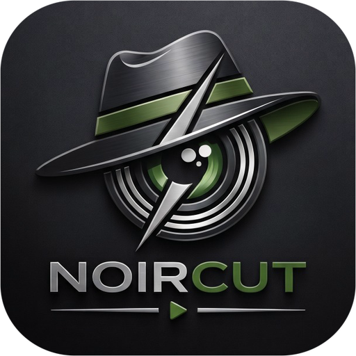
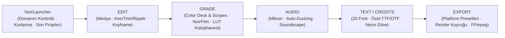

<div align="center">



# NOIRCUT STUDIO

**Sinema Karanlık Odası & Masaüstü Video Kurgu / Renk Laboratuvarı**

[](https://github.com/lakhermony/NoirCut)
[](https://github.com/lakhermony/NoirCut)
[](https://github.com/lakhermony/NoirCut)

*Aboneliksiz, bulut kilitsiz, yerel GPU renk motoru ve gömülü FFmpeg gücüyle çalışan modern doğrusal olmayan video düzenleyici (NLE).*

[Özellikler](#temel-özellikler) · [Çalışma Alanları](#çalışma-alanları) · [Kurulum & Geliştirme](#kurulum-ve-geliştirme) · [Klavye Kısayolları](#klavye-kısayolları) · [Dokümantasyon](#dokümantasyon)

</div>

---

## Vizyon ve Yaklaşım

**NoirCut**, klasik ağır kurgu yazılımlarının karmaşıklığı ile bulut/abonelik dayatan araçlar arasında sıkışan bağımsız sinemacılar, video-essay yapımcıları ve atmosferik içerik üreticileri için tasarlanmıştır.

- **Tamamen Yerel ve Çevrimdışı:** Videolarınız ve sesleriniz hiçbir uzak sunucuya yüklenmez; medya analizi, renk işleme ve dışa aktarma tamamen kendi bilgisayarınızda gerçekleşir.
- **Önizleme = Çıktı Tutarlılığı:** Monitörde WebGL2 GPU ile gördüğünüz renk derecelendirme, 3D LUT, transform keyframe ve ses karışımı; dışa aktarmada aynı matematikle FFmpeg'e (`bakeColorGradeToCube` + `filter_complex`) işlenir.
- **Karanlık Oda Estetiği:** 5 yerleşik tema (**NoirCut Lime `#B7E36A`**, **Saf Monokrom**, **Gece Mavisi**, **Sıcak Tungsten**, **NoirCut Kırmızısı `#E11D48`**) ile göz yormayan yüzen panel (floating UI) mimarisi.

---

## Temel Özellikler

### 1. Akıcı Kurgu Çekirdeği (`EDIT`)
- **Geniş Medya Desteği:** Video (`MP4`, `MOV`, `MKV`, `WEBM`), harici ses (`MP3`, `WAV`, `AAC`, `FLAC`, `OGG`, `M4A`) ve statik görsel (`PNG`, `JPG`, `JPEG`, `WEBP`) içe aktarma.
- **Otomatik Uyumluluk Proxy'si:** Tarayıcı oynatıcısında doğrudan çözülemeyen codecler (ör. HEVC / ProRes) arka planda otomatik H.264+AAC proxy'ye dönüştürülür.
- **Hassas Zaman Çizelgesi:** `V2` (Metin/Jenerik), `V1` (Ana Video/Görsel), `A1` (Diyalog), `A2` (Müzik/Ambiyans) kanalları; sürükleyerek klip taşıma, canlı **Mıknatıs (Snap)** kılavuzu, **sol/sağ kenar kırpma (Edge Trim)**, **Razor (`C`)**, **Ripple Modu / Ripple Silme (`Shift+Del`)** ve **Boşluk Kapatma**.
- **Yönetmen & Klip Araçları:** `In/Out` (`I`/`O`) aralık işaretleme, 5 renkli notlu **Sahne İşaretçileri (`Case Markers - M`)**, 50 adımlı **Geri Al / Yinele**, klip içi **Transform & Keyframe (`linear` / `ease-in-out`)**, hız kontrolü (`%25–%400`), ters oynatma (**Reverse**) ve geçişler (`Cross Dissolve`, `Dip to Black`).

### 2. WebGL2 Renk Laboratuvarı & NoirFilm Studio (`GRADE`)
- **COLOR DECK & SCOPES:**
  - *Temel Ayarlar & WB:* Kamera profilleri (`Rec.709`, `S-Log3`, `C-Log`, `V-Log`, `Log-C`), **Auto WB**, monitör üstü **Damlalık (Eyedropper)**, Temp/Tint, Exposure, Contrast, Highlights, Shadows, Vibrance, Saturation, Vignette ve sağ panelde **Lift · Gamma · Gain · Offset** renk tekerlekleri.
  - *Canlı Video Skopları:* **RGB Parade**, **Waveform**, **Vectorscope**, **Histogram** (video ve statik görseller üzerinde canlı), **False Color** ve **Safe Frames** (`2.39:1`, `16:9`, `9:16`).
  - *Eğriler:* Luma & R/G/B eğri düzenleyici ile Hue-vs-Hue / Hue-vs-Saturation.
- **NOIRFILM STUDIO:**
  - 12 kategoride sinematik **Noir Looks** kütüphanesi, **35mm / 16mm / 8mm Dijital Film Emülasyonu**, organik **Film Texture / Grain**, yığılabilir **Halation, Bloom, Diffusion, Mist** ışık motorları ve favori görünüm / `.noirlook` dışa-içe aktarma (`MY LOOKS`).
- **LUT KÜTÜPHANESİ:**
  - Tam genişlikte aranabilir ve filtrelenebilir galeri (`Tümü`, `Gerilim & Korku`, `Neo-Noir & Gece`, `35mm Film`, `Stüdyo`, `Özel .cube`), **18 renk şablonu**, **19 dahili 3D LUT**, özel `.cube` yükleme ve canlı yoğunluk/efekt kontrolleri.
- **Referans & Karşılaştırma:** Before/After bölünmüş ekran (`Wipe`), tam ekran kıyaslama, **Kare Yakala (Grab Still)** ve klip arası renk kopyala/yapıştır.

### 3. Ses Stüdyosu & Prosedürel Soundscape (`AUDIO`)
- `V1 / A1 / A2` kanal mikseri (`Mute`, `Solo`), klip bazlı kazanç (`-60 dB .. +12 dB`), Sol/Sağ Pan (`-100 .. +100`), sürüklenebilir **Fade In / Fade Out** tutamaçları ve 4000 Hz PCM gerçek ses dalga formu çizimi.
- **Auto-Ducking (Diyalog Önceliği):** `V1`/`A1` sesleri aktifken `A2` müzik kanalını yumuşak geçişle otomatik `-11 dB` kısma (hem önizlemede hem FFmpeg export'ta).
- **Audio FX & Prosedürel Foley:** `Denoise` ve `Sinematik Bas` ön ayarları ile timeline'a doğrudan eklenebilen 4 prosedürel `Noir Soundscape` (`Gerilim Riser`, `Sub Drop`, `35mm Film Projektörü`, `Gece Yağmuru`).

### 4. Kült Sinema Tipografisi & Jenerik Stüdyosu (`TEXT / CREDITS`)
- **5 Hazır Şablon:** `Classic Rolling Credits`, `Noir Opening Title`, `Minimalist Lower Third`, `Chapter / Act Card` ve `Serbest Metin (Text)`.
- **20 Kategorize Font + Özel Font Yükleyici:** *Horror/Slasher/Occult* (`Nosifer`, `Creepster`, `Butcherman`, `Eater`, `Metal Mania`, `UnifrakturMaguntia`), *Noir/Pulp* (`Six Caps`, `Bebas Neue`, `Anton`, `Archivo Black`, `Black Ops One`, `Abril Fatface`), *Klasik* (`Cinzel Decorative`, `Playfair Display`, `Cormorant Garamond`, `Bodoni Moda`, `Syne`) ve *Senaryo/Analog* (`Special Elite`, `Courier Prime`, `VT323`) — ayrıca **`.ttf` / `.otf` / `.woff2` yükleme** (`FontFace` API).
- **Akıllı Araçlar:** Tek tıkla **TR → EN Harf Dönüştürücü (`Ğ→G, Ş→S, İ→I`)**, Harf Aralığı, Satır Yüksekliği, Metin Gölgesi / **Neon Glow Rengi**, Daktilo efekti, 35mm Gate Weave ve sentetik Foley ses senkronu.

### 5. Çıktı Stüdyosu & Başlatıcı (`EXPORT` & `NoirLauncher`)
- **Esnek Dışa Aktarma:** `1080p`, `4K`, `Dikey Sosyal Medya (1080×1920)`; `24 / 30 / 60 fps`; `MP4 / MOV`; 4 hazır platform profili (**YouTube 4K Master**, **Reels / TikTok / Shorts**, **Sinema 24p Noir**, **Hızlı Taslak**).
- **Render Kuyruğu & Aralık Export:** Birden fazla çözünürlük/format işini sıraya ekleme, yalnızca `In–Out` aralığını dışa aktarma, donanım kodlayıcı yoklaması (`NVENC` / `VAAPI` / `QSV` / `AMF` ve otomatik `libx264` fallback).
- **Güvenli Çalışma & Kurtarma:** 8 saniye aralıklı otomatik arka plan yedekleme (son 10 sürüm anlık görüntüsü), beklenmedik kapanışlarda **Oturum Kurtarma**, `.noircut` proje kaydet/aç ve `electron-updater` güncelleme merkezi.

---

## Çalışma Alanları



---

## Kurulum ve Geliştirme

### Son Kullanıcı Kurulumu
- **Linux (x64):** [Releases](https://github.com/lakhermony/NoirCut/releases) sayfasından `.AppImage` dosyasını indirin (veya kaynak koddan üretin), çalıştırma izni verin ve başlatın:
  ```bash
  chmod +x NoirCut-1.0.3.AppImage
  ./NoirCut-1.0.3.AppImage
  ```
- **Windows (x64):** Taşınabilir `.exe` (portable) veya NSIS kurulum sihirbazı ile kurulumsuz ya da klasik Windows uygulaması olarak çalıştırılabilir *(paketleme sırasında `resources/bin/win/ffmpeg.exe` gerektirir)*.

### Geliştirici Kurulumu

**Gereksinimler:** Node.js `>= 20` ve npm.

```bash
# 1. Depoyu klonlayın
git clone https://github.com/lakhermony/NoirCut.git
cd NoirCut

# 2. Bağımlılıkları yükleyin
npm install

# 3. Geliştirme modunda başlatın (Electron + Vite HMR)
npm run dev

# 4. Tip kontrolü ve üretim derlemesi
npm run typecheck
npm run build
```

### Masaüstü Paketi Oluşturma
```bash
# Linux AppImage (dist/NoirCut-1.0.3.AppImage)
npm run dist:linux

# Windows Portable & NSIS Setup (resources/bin/win/ffmpeg.exe mevcutsa)
npm run dist:win
```

---

## Klavye Kısayolları

| Kısayol | İşlev |
| :--- | :--- |
| `Space` | Oynat / Durdur |
| `J` / `K` / `L` | Geri sar (`1x`/`2x`) · Durdur · İleri oynat (`1x`/`2x`/`4x`) |
| `C` | Playhead konumundan kes (Razor) |
| `Del` / `Backspace` | Seçili klibi sil *(Ripple Modu açıksa sonraki klipleri kaydırır)* |
| `Shift + Del` | **Ripple Sil** — Klibi sil ve boşluğu otomatik kapat |
| `I` / `O` | Giriş (In) ve Çıkış (Out) noktası işaretle |
| `M` | Sahne İşaretçisi (`Case Marker`) ekle |
| `Ctrl + Z` / `Ctrl + Shift + Z` | Geri Al / Yinele (50 adım) |
| `Ctrl + S` / `Ctrl + O` | Projeyi Kaydet / Proje Aç |
| `Ctrl + Fare Tekerleği` | Zaman çizelgesini yakınlaştır / uzaklaştır |

---

## Mimari Dizin Yapısı

```text
src/
├── main/                   # Electron ana süreç (FFmpeg motoru, proxy, medya protokolü, export, autosave, updater)
├── preload/                # contextBridge IPC API (window.noircut)
├── shared/                 # Renderer ve Main arası paylaşılan saf modeller & matematik (color, lut, noirfilm, timeline, credits)
└── renderer/src/           # React 19 arayüzü, WebGL2 shader motoru, çalışma alanları ve Canvas bileşenleri
docs/
├── KULLANIM_KILAVUZU.md    # Son kullanıcı adım adım kullanım rehberi
├── ANALIZ_RAPORU.md        # Kod tabanı teknik analiz raporu
└── OZELLIK_ONERILERI.md    # Ürün keşfi, rakip analizi ve v2/v3 yol haritası
```

---

## Dokümantasyon

- **[Son Kullanıcı Kullanım Kılavuzu](docs/KULLANIM_KILAVUZU.md):** Kurgu, NoirFilm Studio, LUT Kütüphanesi, tipografi ve dışa aktarma adımları.
- **[Teknik Kod Analizi Raporu](docs/ANALIZ_RAPORU.md):** Mimari inceleme, güvenlik ve teknik bulgular.
- **[Özellik Önerileri ve Yol Haritası](docs/OZELLIK_ONERILERI.md):** Mevcut durum envanteri, 8 rakip incelemesi ve gelecek sürümler (`v2`/`v3`) planı.

---

<div align="center">

**NoirCut Studio** · Copyright © 2026 NoirCut Studio

</div>
